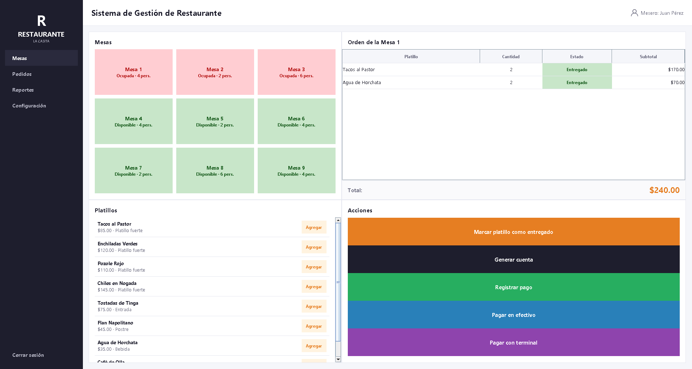
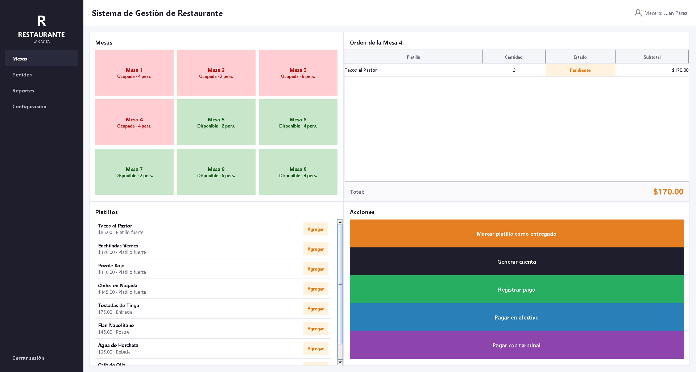

# Fase 3: Interfaz gráfica con Swing y GUI Designer

## Estructura de la interfaz

La ventana principal se construyó con Swing y se dividió en tres zonas:

| Zona | Contenido |
|---|---|
| Barra lateral | Logotipo, nombre del restaurante y botones Mesas, Pedidos, Reportes, Configuración y Cerrar sesión |
| Barra superior | Título de la aplicación y datos del usuario: Mesero: Juan Pérez |
| Área central | Grid de mesas 1 a 9, orden de la mesa seleccionada, lista de platillos y botones de acción |

El área central utiliza un `GridBagLayout` con dos columnas y dos filas:

| Posición | Panel | Porcentaje |
|---|---|---|
| Superior izquierda | Mesas | 38 % del ancho, 56 % del alto |
| Superior derecha | Orden de la mesa | 62 % del ancho, 56 % del alto |
| Inferior izquierda | Platillos | 38 % del ancho, 44 % del alto |
| Inferior derecha | Acciones | 62 % del ancho, 44 % del alto |

Cada panel tiene borde, fondo blanco y un título propio. La tarjeta de la orden incluye la tabla y una franja inferior con el total.

## Paleta de colores

| Elemento | Color |
|---|---|
| Barra lateral | `#1E1E2D` |
| Barra lateral activa | `#2A2A3D` |
| Acento naranja | `#E67E22` |
| Fondo del área central | `#F5F6FA` |
| Texto principal | `#1E1E2D` |
| Texto secundario | `#6C6C80` |
| Mesa disponible | Fondo `#C8E6C9`, texto `#1B5E20` |
| Mesa ocupada | Fondo `#FFCDD2`, texto `#B71C1C` |
| Botón de entrega | `#E67E22` |
| Botón de cuenta | `#1E1E2D` |
| Botón de pago | `#27AE60` |
| Botón de efectivo | `#2980B9` |
| Botón de terminal | `#8E44AD` |

## GUI Designer

La vista se compone de dos archivos enlazados:

```text
src/vista/
├── VentanaPrincipal.form
└── VentanaPrincipal.java
```

El formulario declara `bind-to-class="vista.VentanaPrincipal"` y enlaza 39 componentes con campos privados del mismo nombre. Todos los campos se declaran `private` y se inicializan desde `$$$setupUI$$$()`.

Para abrir el diseño en IntelliJ IDEA:

1. Abrir `VentanaPrincipal.form`.
2. Verificar que la clase enlazada sea `vista.VentanaPrincipal`.
3. En `Settings > Editor > GUI Designer` elegir `Generate GUI into: Java source code`.

Con esa configuración, el método `$$$setupUI$$$()` escrito en el archivo Java se conserva y el proyecto compila tanto con el compilador de IntelliJ como con `javac` desde la terminal.

## Componentes principales

| Campo | Tipo | Función |
|---|---|---|
| `panelLateral` | `JPanel` | Contenedor de la barra lateral oscura |
| `botonMesas` | `JButton` | Recarga las mesas y vuelve al panel principal |
| `botonPedidos` | `JButton` | Muestra el resumen de pedidos activos |
| `botonReportes` | `JButton` | Muestra ocupación y total pendiente |
| `botonConfiguracion` | `JButton` | Muestra los datos del sistema y la ruta de la base |
| `botonCerrarSesion` | `JButton` | Confirma la salida del sistema |
| `panelBotonesMesas` | `JPanel` | Grid 3 × 3 con las mesas |
| `tablaOrden` | `JTable` | Columnas Platillo, Cantidad, Estado y Subtotal |
| `etiquetaTotal` | `JLabel` | Total de la cuenta de la mesa |
| `panelListaPlatillos` | `JPanel` | Lista de platillos con precio y botón Agregar |
| `botonMarcarEntregado` | `JButton` | Cambia el estado del platillo seleccionado |
| `botonGenerarCuenta` | `JButton` | Muestra el detalle de la cuenta |
| `botonRegistrarPago` | `JButton` | Permite elegir el método de pago |
| `botonPagoEfectivo` | `JButton` | Registra el pago en efectivo |
| `botonPagoTerminal` | `JButton` | Registra el pago con terminal |

La cabecera del usuario utiliza el icono vectorial `IconoUsuario`, dibujado con `Graphics2D` para no depender de fuentes de emojis del sistema.

## Tabla de la orden

La tabla se construye con un `DefaultTableModel` no editable. Los estados se muestran con un renderizador propio:

- `Entregado`: fondo verde claro y texto verde oscuro.
- `Pendiente`: fondo naranja claro y texto naranja.

Las columnas de cantidad y subtotal se alinean al centro y a la derecha. El total se recalcula cada vez que se agrega, entrega o cobra un platillo.

## Capturas de la interfaz

Vista general con la mesa 1 ocupada y su orden:



Pedido pendiente agregado a la mesa 1. El total se actualiza a $325.00:


Mesa 4 seleccionada desde el grid. Al estar disponible, la mesa cambia a ocupada y se registra el pedido:



## Compilación de la fase

```text
javac -encoding UTF-8 --release 17 -cp lib\sqlite-jdbc-3.54.1.0.jar -d out\clases src\modelo\*.java src\datos\*.java src\negocio\*.java src\vista\*.java
```

La interfaz se inicia con la clase `vista.Principal`.
