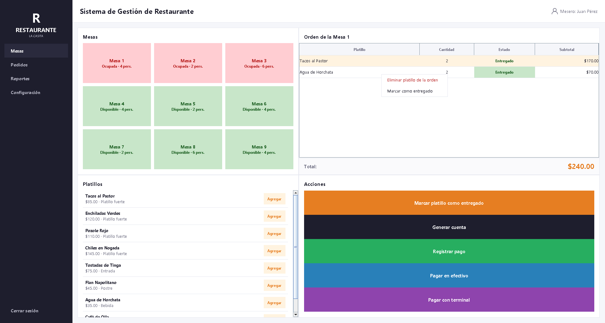

# Fase 4: Lógica de negocio y eventos

## Capa de servicio

La clase `negocio.ServicioRestaurante` concentra las reglas del restaurante y es la única capa que la ventana utiliza para hablar con la base de datos.

| Método | Regla que aplica |
|---|---|
| `cargarMesas()` | Lee las mesas, las ordena por número y actualiza la caché interna |
| `obtenerMesas()` | Devuelve las mesas cargadas, ordenadas por número |
| `obtenerMesa(int)` | Busca una mesa por su número visible |
| `abrirMesa(int)` | Si la mesa está disponible, la marca como ocupada en la base y en memoria |
| `obtenerPedidosMesa(int)` | Devuelve las líneas no pagadas de la mesa |
| `obtenerPedidosActivos()` | Devuelve todas las líneas con `pagado = 0` |
| `agregarPlatillo(int, Platillo)` | Suma una unidad a la línea pendiente del mismo platillo o inserta una nueva línea |
| `marcarEntregado(Pedido)` | Cambia el estado de la línea a `Entregado` en la base y en el objeto |
| `eliminarPedido(Pedido)` | Borra la línea de la orden con `DELETE` sobre `pedidos` |
| `liberarMesaSiEstaVacia(int)` | Libera la mesa cuando ya no tiene líneas pendientes |
| `calcularTotalMesa(int)` | Suma los subtotales pendientes de la mesa |
| `calcularTotalPendiente()` | Suma los subtotales pendientes de todo el restaurante |
| `registrarPago(int, String)` | Marca las líneas como pagadas, guarda el método y la fecha, y libera la mesa |
| `contarMesasOcupadas()` | Cuenta las mesas en estado `Ocupada` |

`buscarMesa(int)` es privado y lanza `ExcepcionBaseDatos` cuando el número no existe. `registrarPago` valida que el método sea `Efectivo` o `Terminal` antes de escribir.

## Reglas implementadas

### Ocupar una mesa

Al hacer clic en una mesa disponible:

1. `seleccionarMesa` llama a `ServicioRestaurante.abrirMesa`.
2. `MesaDAO.cambiarEstado` ejecuta `UPDATE mesas SET estado = 'Ocupada'`.
3. El botón cambia de verde a rojo y la orden de la mesa se carga en la tabla.

### Agregar un platillo

Al pulsar Agregar:

1. Se buscan las líneas pendientes de la mesa.
2. Si existe una línea `Pendiente` con el mismo platillo, se incrementa la cantidad con `UPDATE`.
3. Si no existe, se inserta una línea nueva con estado `Pendiente` y subtotal calculado.
4. La tabla y el total se reconstruyen desde la base de datos.

### Marcar como entregado

1. Se exige una fila seleccionada en la tabla; si no hay, se muestra un `JOptionPane` de advertencia.
2. `PedidoDAO.marcarEntregado` ejecuta `UPDATE pedidos SET estado = 'Entregado'`.
3. La tabla se recarga y la fila queda con fondo verde y la selección se conserva.

### Eliminar un platillo de la orden

El mesero puede corregir la orden de dos maneras:

1. Con clic derecho sobre la fila: aparece el menú contextual con las opciones `Eliminar platillo de la orden` y `Marcar como entregado`.
2. Con la tecla `Supr` sobre la fila seleccionada.

El flujo es:

1. Se exige una fila seleccionada; si no hay, se muestra un `JOptionPane` de advertencia.
2. Se pide confirmación indicando cantidad y nombre del platillo.
3. `ServicioRestaurante.eliminarPedido` llama a `PedidoDAO.eliminar`, que ejecuta `DELETE FROM pedidos WHERE id_pedido = ?`.
4. `liberarMesaSiEstaVacia` comprueba si quedan líneas pendientes; si la orden quedó vacía, la mesa vuelve a `Disponible`.
5. La tabla, el total y el color de la mesa se actualizan.



### Generar la cuenta

Se arma un detalle con cantidad, platillo y subtotal de cada línea pendiente, más el total. Si la mesa no tiene líneas, se informa con `JOptionPane`.

### Registrar el pago

1. Se valida que la mesa tenga una cuenta pendiente.
2. Se confirma el total y el método elegido.
3. `PedidoDAO.registrarPagoMesa` ejecuta:

```sql
UPDATE pedidos
SET pagado = 1, metodo_pago = ?, fecha_pago = CURRENT_TIMESTAMP
WHERE id_mesa = ? AND pagado = 0;
```

4. `MesaDAO.cambiarEstado` libera la mesa.
5. El botón vuelve a verde, la orden queda vacía y el historial permanece en la tabla `pedidos`.

El pago no elimina registros: conserva `pagado`, `metodo_pago` y `fecha_pago` para los reportes y para la trazabilidad.

## Manejo de errores en la interfaz

Todos los accesos a datos se envuelven en `try/catch` de `ExcepcionBaseDatos`. Cuando ocurre una falla se muestra:

```text
Error de base de datos
<descripción de la operación>
<detalle del error>
```

También se muestran avisos con `JOptionPane` cuando:

- No hay una mesa seleccionada.
- No hay un platillo seleccionado en la tabla.
- Se intenta eliminar un platillo sin seleccionar una fila.
- La mesa no tiene cuenta pendiente.
- Se intenta pagar una mesa sin consumos.
- El usuario cancela la confirmación de pago, de eliminación o de cierre de sesión.

## Eventos conectados

| Control | Evento | Acción |
|---|---|---|
| Botón de mesa | `ActionListener` | Ocupa la mesa y carga su orden |
| Botón Agregar | `ActionListener` | Inserta o incrementa el platillo |
| Marcar platillo como entregado | `ActionListener` | Actualiza el estado de la línea |
| Menú contextual de la orden | `MouseListener` | Selecciona la fila y abre Eliminar o Marcar como entregado |
| Tecla Supr en la orden | `KeyStroke` y `AbstractAction` | Elimina el platillo seleccionado |
| Generar cuenta | `ActionListener` | Muestra el detalle y el total |
| Registrar pago | `ActionListener` | Pregunta el método y confirma |
| Pagar en efectivo | `ActionListener` | Registra el pago con método `Efectivo` |
| Pagar con terminal | `ActionListener` | Registra el pago con método `Terminal` |
| Mesas | `ActionListener` | Recarga las mesas desde la base |
| Pedidos | `ActionListener` | Resume los pedidos activos |
| Reportes | `ActionListener` | Muestra ocupación y total pendiente |
| Configuración | `ActionListener` | Muestra la ruta de la base |
| Cerrar sesión | `ActionListener` | Confirma y cierra la aplicación |

## Validación ejecutada

Se copió `restaurante.db` a un directorio temporal y se ejecutó una prueba sobre `ServicioRestaurante`:

- Nueve mesas cargadas.
- Mesa 4 disponible al inicio.
- Apertura de la mesa 4 y cambio a `Ocupada`.
- Dos unidades de Tacos al Pastor y una de Agua de Horchata.
- Dos líneas de pedido y total de $205.00.
- Marcado del primer platillo como entregado.
- Apertura de la mesa 5 con dos líneas de pedido por $120.00.
- Eliminación del postre: una línea y total de $75.00.
- Intento de liberar la mesa 5 con pedidos pendientes: rechazado.
- Eliminación de la última línea: la mesa 5 se libera y queda disponible.
- Pago en efectivo por $205.00.
- Mesa 4 liberada y sin pedidos pendientes.
- Total pendiente global de $625.00.
- Tres mesas ocupadas después del cobro.
- Recarga de mesas sin perder los identificadores.

Resultado:

```text
PRUEBA DEL SERVICIO CORRECTA
Ruta de la base de datos: C:\...\restaurante_prueba\restaurante.db
```

La base original permaneció con nueve mesas, cinco pedidos y ningún pago registrado.

## Integración con la interfaz

Las capturas de la fase 3 se generaron ejecutando la ventana real sobre una copia de la base:

- La mesa 1 muestra sus dos líneas entregadas y el total de $240.00.
- Al agregar Tacos al Pastor aparece una línea pendiente y el total sube a $325.00.
- Al seleccionar la mesa 4, ésta cambia a ocupada y registra dos unidades de Tacos al Pastor por $170.00.
- El menú contextual de la orden se abre con clic derecho sobre una fila.

La eliminación se probó con la acción de la tecla Supr sobre la mesa 1:

- Primera eliminación: queda una línea y el total baja a $70.00; la mesa sigue ocupada.
- Segunda eliminación: la orden queda vacía, la mesa vuelve a `Disponible` y no quedan pedidos.

## Compilación

```text
javac -encoding UTF-8 --release 17 -cp lib\sqlite-jdbc-3.54.1.0.jar -d out\clases src\modelo\*.java src\datos\*.java src\negocio\*.java src\vista\*.java
```
